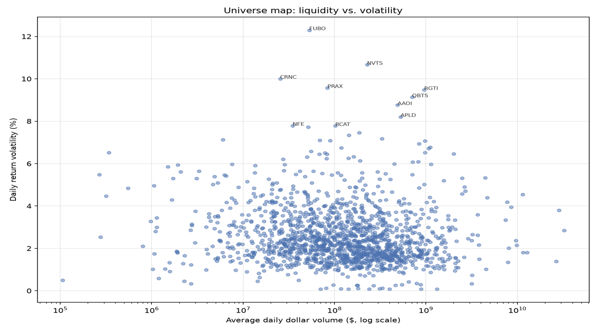

## Model

Each horizon is an independent ridge regression on log-returns. They are defined in the C part of the code:
```
int NR_HORIZONS = 4;
int HORIZONS[4] = {1, 5, 10, 20};
```
The Python side reads this definition and creates the appropriate *model_weights* file, while the C side trains every horizon listed.

by default, for 72 detailed short horizon features per sample:

| Horizon | Look-ahead | Weight slice | Bias index |
|---|---|---|---|
| 1 day  | `t + 1`  | `weights[0:72]`    | `bias[0]` |
| 5 day  | `t + 5`  | `weights[72:144]`  | `bias[1]` |
| 10 day | `t + 10` | `weights[144:216]` | `bias[2]` |
| 20 day | `t + 20` | `weights[216:288]` | `bias[3]` |

All parameters flow through both training stages: first fit across the whole universe, then finetune to one company at a time.

## Training - 2 stages

### Stage 1 | Cross-sectional pretraining

Which days are trainable can be decided by different training rules (*model/utils/train_rules.c*). A rule can describe any pattern of held-out periods, such as a single continous calendar window or a 30-day holdout every 90 days. The same rules are used by pretraining, finetuning and forecasting, synchronized using Unix timestamps, so all three always agree on what the model has and hasn't seen.

Training walks forward through calendar time across the *entire* company universe, skipping the held-out periods:

1. At each trading day, compute the prediction error for every company in the universe and average the gradient across all of them: a full batch over the cross-section, to minimize the effects of constant Market features among all companies on that day.
2. After a full pass, recompute RMSE on all 4 horizons. If every horizon got strictly worse, halve the learning rate, otherwise repeat.

The weights are also constantly saved statically on disk every couple of cycles during training.

### Centering and scaling

All features are computed once at startup for every sample, in parallel, and reused across training cycles.

They are centered, clipped and scaled using each feature's row's mean and standard deviation.

Multilinearity between features is likely, due to most of them being logs derived from the same kind of data, therefore Ridge Regression is needed. The lambda penalty penalizes equally, so standardization is needed.

Even though the features were chosen to be around the same scale, without centering and scaling, they drift apart dramatically, illustrated by the graphs below:

<p align="center">
  
</p>

### VS

Scaled & centered (**NOT CLIPPED**) features' IQR

<p align="center">
  
</p>


### Stage 2 | Per-ticker finetuning & calibration

Every time a forecast is requested for a ticker, the pretrained weights are adapted specifically to that company before predicting, using ridge regression once again.

If the most recent bar in the data belongs to today's still-open session, it's excluded from both fine-tuning and calibration, so the model never finetunes or predicts on a price that hasn't closed yet.

1. **Fine-tune** on that one company, over its whole history except the held-out periods.
2. **Calibrate** on the held-out periods only. Predictions there are compared against what actually happened, giving the per-horizon bias and after removing it, the residual standard deviation. Neither stage fit on that window, so these are real out-of-sample residuals for this ticker.
3. **Predict** from the last closed bar, apply the bias, divide by the residual standard deviation for the forecast strength.


## Training universe

One JSON file per company, plus a single SPY file used as the market reference. All are aligned in time and for each day they reveal `v`, `vw`, `o`, `c`, `h`, `l`, `t`, `n`.

A company enters the universe only if:
 
- every field of every sample is strictly positive
- the history is complete and unbroken over the full data range

Everything else is dropped by the scraper. The same check runs before a forecast, so a ticker that could not have entered training cannot be predicted on either.

<!-- 


 -->

<table width="1200" align ="center">
  <tr>
    <td width="400"></td>
    <td width="400"></td>
  </tr>
  <tr>
    <td></td>
    <td></td>
  </tr>
</table>